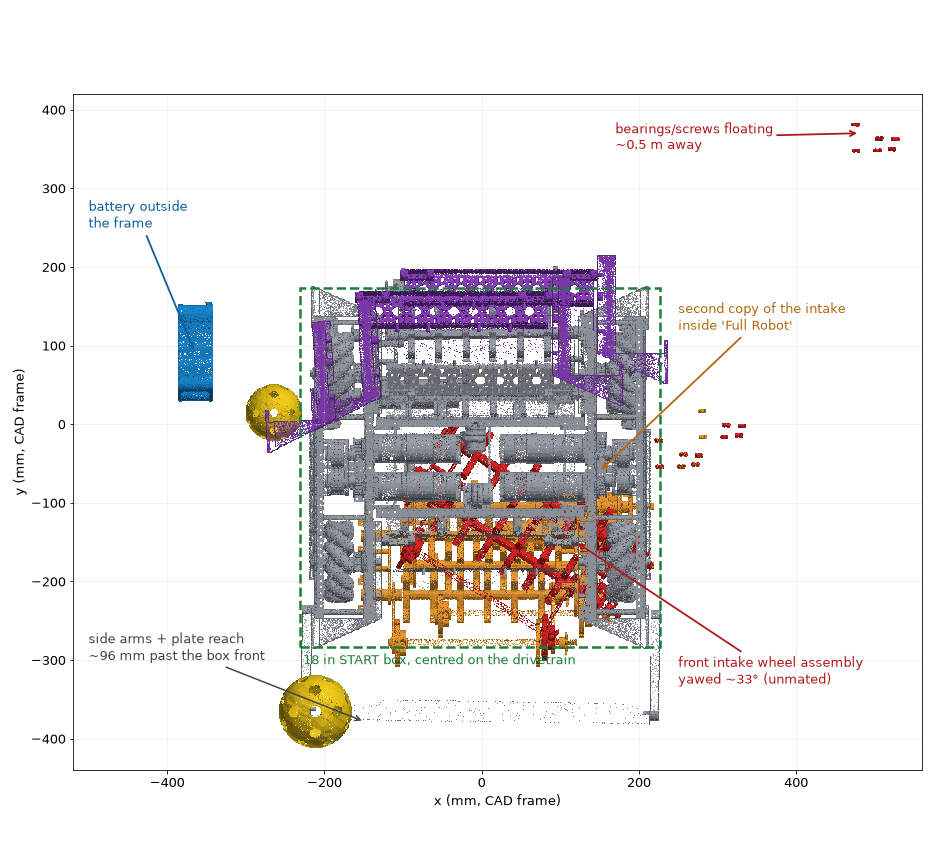
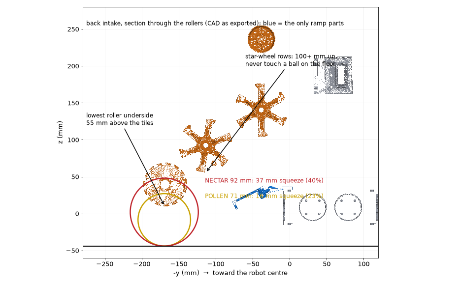
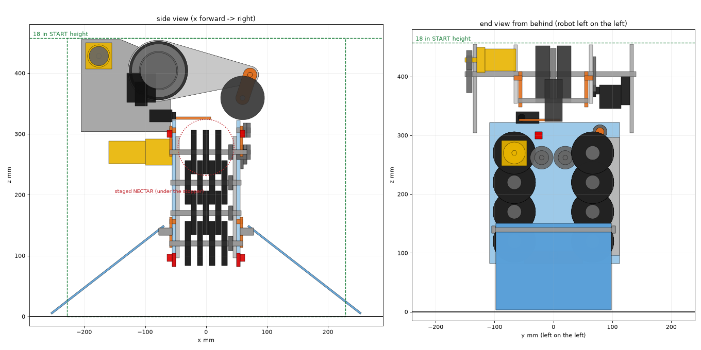
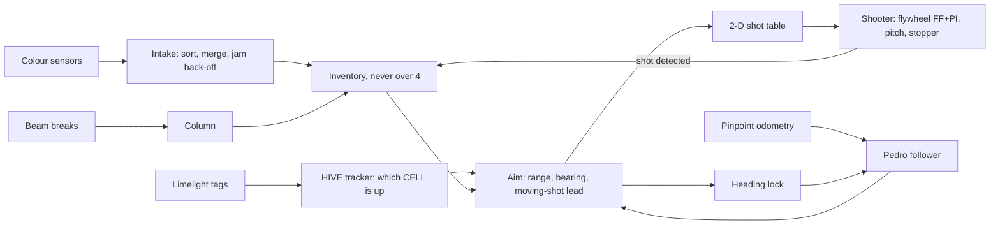

# BIOBUZZ Robot · FTC 2026–27

[](https://github.com/LILRINO71/biobuzz-robot-2026/actions/workflows/sim.yml)

My engineering work on our team's robot for the 2026–27 *FIRST* Tech Challenge game, **BIOBUZZ**. It covers:

- a part-by-part review of the team's 1,646-part Onshape assembly;
- a transfer and shooter I designed to fit it, with CAD;
- a shot map built from a physics simulation;
- the full robot software (TeleOp, a two-cycle autonomous and tuning tools), tested in a simulator I built, with CI that runs the autonomous on every push.

**[Read the full design review →](https://lilrino71.github.io/biobuzz-robot-2026/)**

| | |
|---|---|
| CAD review | 7 findings, including the one that matters most on the field: the intake can't lift a ball |
| Transfer + shooter | Single-file column and a zero-spin two-wheel shooter on one motor: **97–99% simulated hit rate** from every scoring spot |
| Software | 24 Java classes on Pedro Pathing. Colour sorting enforces two game rules (G407, G408); flywheel control holds speed as the battery sags; shoot-on-the-move; jam recovery |
| Verified | The autonomous fires **10 balls, rejects both opponent balls and parks at 24 s** in [FTC SimBench Pro](https://github.com/LILRINO71/ftc-simbench-pro). The code's shot table is checked against the physics sim on every push |

## The game in one paragraph

Robots score hollow, perforated balls into the upward-facing CELL of a HIVE at the field centre. That means POLLEN (2.80 in, 25 g) and their own alliance's NECTAR (3.62 in, 41 g); the opponent's NECTAR must be left alone. When enough mass lands in the CELL (174–199 g), the HIVE tips (a TIP, 20 points), spills the balls on that side, and brings the other CELL up. A robot may hold at most 4 balls (rule G407) and must not control the opponent's NECTAR (G408). The mouth's lip is 53.5 in up and tilted 60°, so every shot is a steep lob.

## 1 · What the CAD review found

I wrote a pipeline to check the 106 MB Onshape export:
- parse it with my simulator's STEP parser;
- mesh each of its 265 unique shapes once with OpenCascade;
- render millions of triangles as views and section cuts with a numpy z-buffer.



- **Unmated parts:**
  - the front intake is yawed 33°;
  - a second copy of the intake is buried in a sub-assembly;
  - the ramp copies hang 70–85 mm below the floor;
  - the battery sits outside the frame;
  - bearings float half a metre away.

  Mass and interference checks are meaningless until these are fixed.
- **About 19.1 in long** as drawn, against an 18 in starting-size limit.
- **The intake can't lift a ball.** The lowest roller is 55 mm off the tiles. It squeezes a POLLEN by 23% and a NECTAR by 40%, and nothing under the ball pushes back. The star wheels above it never reach a ball on the floor. One fixed gap can't serve both ball sizes, so the fix is a sprung ramp under each roller chain.



## 2 · Transfer and shooter



- **Column transfer.** It sits in the 116 mm centre bay where both intakes deliver. Two stacks of 72 mm Gecko wheels, one on a sprung swing plate, lift both ball sizes single file to a servo stopper.
- **Shooter.** A 96 mm wheel and a sprung 72 mm wheel, belted 4:3 so their surfaces match and the ball leaves without spin. That matters because another team measured 44% of backspun balls bouncing out of the CELL. One goBILDA 6000 rpm motor drives it through a 2:1 belt; [I compared 9 motor/gear options](analysis/shot-map/compare-motors.mjs) in the physics sim first.
- **Pitch.** 60–87°, pivoting on the wheel shaft so the belt never changes length. The robot aims with its chassis, which keeps the whole robot within the 8-motor limit.
- **CAD.** [`cad/biobuzz-transfer-outtake.step`](cad/) opens cleanly in OpenCascade. It's generated from code (`cad/gen/`) and checked for clashes against the team's robot. The check turned up three open decisions, listed under [Status](#status).

## 3 · Shot map from physics

A 1-D "distance → speed" table isn't enough here. From the side of the CELL, a shot needs up to 8° more pitch than one from straight in front at the same distance. [`make_shot_table.mjs`](analysis/shot-map/make_shot_table.mjs) asks the physics sim ([biobuzz-shot-sim](https://github.com/LILRINO71/biobuzz-shot-sim): drag, Magnus and the real CELL geometry) for the best pitch and speed at every range from 12.5 to 70 in and every bearing from 0 to 75°, for both balls. The robot then interpolates between them. The wheel rpm comes from one measured constant, so tuning the whole table on the real robot takes two test distances.

## 4 · Software



Each feature fixes a problem FTC teams commonly hit (from [my research](docs/research.md)):

| Problem | What the code does |
|---|---|
| Flywheel sags after each shot; "ready" flickers | Feedforward + PI scaled by battery voltage, full power when more than 12% slow, ready band with hysteresis (3% in, 6% out) |
| Two balls fed at once | The column stops the instant the staged ball clears the top beam. The stopper closes when the wheel's speed dip confirms the shot |
| Grabbing the opponent's NECTAR (rule G408) | Every ball is colour-classified at the intake mouth, even when balls arrive back to back. The intake slows until a ball is classified, then spits out the wrong ones |
| Holding a 5th ball (rule G407) | Counts balls held and on their way in; both intakes stop and push away extras at 4 |
| Jams | Current-based stall detection with back-off; a column that can't stage a ball flags itself |
| AprilTags ride on the moving HIVE | Tags only tell which CELL is up, never where the robot is. Position comes from odometry |
| Wasting balls on a CELL that's already going to tip | Tracks grams banked and rumbles the driver at a certain TIP |
| Slow loop times | Manual bulk reads, skipped duplicate motor writes, rate-limited current and colour reads |
| Wrong config names or reversed motors at events | A Hardware Check OpMode that lists, jogs and reads everything |

Code: [`code/`](code/) · setup and controls: [`docs/setup-and-tuning.md`](docs/setup-and-tuning.md).

## 5 · Tested in simulation

The autonomous and TeleOp run unmodified inside [FTC SimBench Pro](https://github.com/LILRINO71/ftc-simbench-pro)'s Java VM, against a model of this robot. To make autos possible, [I added Pedro Pathing path following to the simulator](https://github.com/LILRINO71/ftc-simbench-pro/commit/c8ca613) (5 new tests; 777 pass). CI reruns everything on every push ([`sim/`](sim/)).

| Time | Two-cycle autonomous, red alliance |
|---|---|
| 0.0–3.2 s | Turns to the CELL, spins up, fires the 4 preloads |
| 3.2–6.3 s | Waits for the HIVE to tip |
| 6.3–8.8 s | Sweeps the spill: takes 3 balls, spits out the opponent's NECTAR |
| 8.8–12.7 s | Drives round the HIVE into the LOADING ZONE, fires 3 at the far CELL |
| 12.8–17.8 s | Second TIP; sweeps the far spill, rejecting another opponent NECTAR |
| 17.8–22.0 s | Fires 3 from the side the up CELL now faces |
| 22.1–24.0 s | Parks in the LOADING ZONE, 6 s to spare |

These runs caught four real bugs before the robot ever ran the code: a 5 s wait before the first shot, an opponent ball slipping in behind another, a ball stranded at the intake, and a second cycle that shot from the wrong side. All are fixed.

## Status

- **Not yet run on the real robot.** It compiles against the team's exact SDK and library versions, and every behaviour above was checked in simulation. Hardware tuning is next ([steps](docs/setup-and-tuning.md)).
- **Open design decisions** from the CAD clash check:
  - The ramp as drawn leaves only 9 mm under the rollers. Either reposition it to (±170, 6)–(±70, 84) mm or raise the roller chain 52 mm.
  - Below 64.5° pitch, the shooter's top wheel reaches the staged ball. Either limit pitch to 65° or lower the stopper 14 mm.
  - A power switch sits inside the sprung roller stack.

## Repo layout

```
code/       robot Java: OpModes + robot/ subsystems (live copy: team repo, branch Testing-code)
cad/        transfer + shooter STEP, its generator, and how to place it in Onshape
analysis/   shot-map generator + motor study; the CAD-review pipeline (parse, mesh, render)
sim/        headless SimBench Pro runs of the real OpModes, with pass/fail checks
docs/       design review (GitHub Pages), research report, setup and tuning, figures
```

## Built with

Java (FTC SDK 11.1.0, Pedro Pathing 2.1.2, Panels) · Node.js · Python (NumPy, Matplotlib) · OpenCascade via occt-import-js. Two tools I built earlier: [FTC SimBench Pro](https://github.com/LILRINO71/ftc-simbench-pro) and [BIOBUZZ Shot Sim](https://github.com/LILRINO71/biobuzz-shot-sim) ([live](https://lilrino71.github.io/biobuzz-shot-sim/)).

The chassis and intake CAD are the team's. I built the review, the transfer and shooter design, the tools and the software, with Claude (Anthropic's AI) doing much of the research, CAD analysis and coding at my direction.
