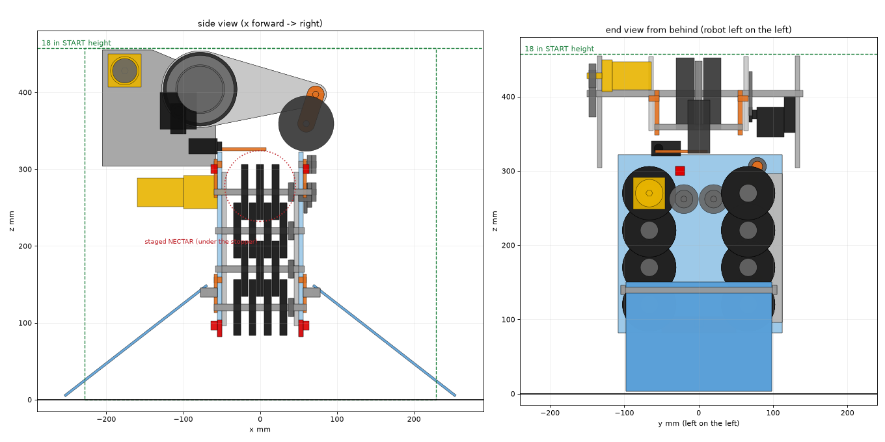

# Transfer + outtake CAD for the dual-intake robot

`biobuzz-transfer-outtake.step` holds the column transfer, the two-wheel shooter and the two floating ramps from the [design review](https://lilrino71.github.io/biobuzz-robot-2026/), as solids you can drop into the robot's Onshape assembly. The code that drives them is in [`code/`](../code/).



## The file

The file is a STEP AP214 assembly in millimetres, with 104 part instances and 110 solids. OpenCascade reads it with no errors.

Everything is drawn in the **robot frame**:

- +x points forward (the shooter fires over the front intake).
- +y points to the robot's left.
- +z points up.
- The origin is the drivetrain centre, on the tiles.

| Sub-assembly | Parts | Origin |
|---|---|---|
| Column Transfer | Walls, IR sills, 4 fixed axles and 14 wheels, 435 rpm motor, link pins, reversing gears, drive pulleys, 4 swing links, IR beams, stopper servo and flap | robot origin |
| ↳ Sprung Stack | 2 swing plates, 4 axles and 14 wheels, pulleys. Drawn at rest | robot origin |
| Shooter Frame | 2 towers, shooter shaft, two 96 mm wheels, flywheel, 6000 rpm motor, 2:1 pulleys, pitch servo with its gear and bracket | robot origin |
| Shooter Pod | 2 side plates, 60T pitch gear, sprung arms, 72 mm top wheel | **on the pivot**, with x along the shot direction. Drawn at 72° |
| Floating Ramp ×2 | Ramp plate, hinge rod, 2 brackets | **on the hinge axis**. The front ramp is the back one turned 180° |

The key numbers, all checked on the OpenCascade read-back:

| | |
|---|---|
| Column | Single-file, 100 mm fore-aft (walls at x ±50), z 82 → 322 |
| Wheel stacks | 72 mm Gecko 30A on fore-aft 8 mm axles at z 120 / 170 / 220 / 270, centres at y ±66.5. The tips are 61 mm apart, so a POLLEN is squeezed 10 mm. The sprung side (−y) sits on a parallel-link swing plate with 25 mm of travel, and a NECTAR needs 21 mm of it. The wheels on alternate axles are staggered in x so each ball is always gripped |
| Drive | goBILDA 435 rpm on fixed axle 4, outside the back wall. A 40T gear pair outside the front wall reverses the drive to the sprung stack, through the top-link jackshaft |
| IR break beams | z 96 (column entry, on the sills, at y 0) and z 300 (top, at y +25). Both shine fore-aft through the walls |
| Stopper flap | Underside at z 324, servo-hinged along x at (y 54, z 330). It opens by swinging up to vertical at y 48–52, clear of a NECTAR |
| Shooter pivot | The 96 mm wheel shaft at (x −78, z 404) |
| Top wheel | 72 mm, 145 mm from the pivot along the normal. At 72° it is centred at (59.9, 359.2). It sits on a 40 mm sprung arm pivoting downstream of it. The nip gap is 61 mm |
| Pitch | 60–87°, set by a 2000-series servo with a 20T gear driving a 60T gear on the pod (3:1) |
| Shooter motor | goBILDA 6000 rpm at (−176, 428), with a 20T → 40T HTD5 belt (2:1) to the pivot shaft. Centre distance 100.9 mm |
| Ramps | 38° (37.9°), top surface from (±255, 6) to (±70, 150), 3 mm thick, 196 mm wide. The lip underside is 3.6 mm off the tiles. The hinge is at (±72.0, 139.6) |
| Height | The highest point is 455 mm (the pod plate around the pivot and the tower tops) at every pitch from 60 to 87°, so it fits under 457.2 at START |

## Put it in the robot's Onshape assembly

1. **Import the file.** In the robot document, use **+ → Import…** and pick `biobuzz-transfer-outtake.step`. Don't flatten the assembly; Onshape will create a Part Studio and an Assembly tab.
2. **Insert it.** In the robot assembly, use **Insert** (Ctrl+I) **→ This document → Assemblies →** the imported assembly. Click once to drop it anywhere.
3. **Align it to the drivetrain centre.** The import's origin has to land on the drivetrain centre on the tiles, and its +x has to point at the robot's front. In your assembly, as exported on 2026-10-18:
   - The **front is −y** and up is +z.
   - The **drivetrain centre on the tiles is at x −2.0, y −55.35, z −44.0 mm**. That is the plan centre of the four mecanum axles, and the tile surface where the wheels touch.

   To place it:
   1. Add a **Mate connector** on a chassis part (or on the assembly Origin).
   2. Give the connector an offset of X −2.0, Y −55.35, Z −44.0 mm and a rotation of **−90° about Z**, so its X axis points along −y (the front).
   3. Add a **Fastened** mate between that connector and the imported assembly's Origin.

   If your assembly origin has moved since that export, measure the drivetrain centre again the same way.
4. **Check the fit.**
   - The column walls should stand on the floor plate between the intake towers. The plate is 82 mm above the tiles, which is z 38 in your assembly.
   - The shooter towers should sit on top of the back intake's 1107 channels.
   - The ramp lips should be at the intake mouths, just above the tiles.
   - If the shooter fires backwards, the rotation sign is wrong. Flip it to +90°.
5. **Make it move (optional).**
   - Replace the Shooter Pod's fasten with a **Revolute** on its origin, about the shooter shaft. 60° is 12° below the drawn pose, and 87° is 15° above it, where the shot is steeper.
   - Put the pod at **87° for START**.
   - Each ramp plate pivots on its hinge rod.
   - The sprung stack moves on two parallel links. Leave it fastened at rest unless you want to show the 25 mm travel.

To regenerate the file and the checks after changing a number in `gen/transfer-outtake.mjs`, run this from the repo root:

```bash
node cad/gen/transfer-outtake.mjs --check
```

The generator needs the ftc-simbench-pro checkout next to this repo, for `tools/stepgen.mjs` and `occt-import-js`. Set `SIMBENCH` if it lives somewhere else.

## Known issues: decide these before cutting parts

These come from checking the new parts against the exported robot (`intake assembly 2`). For that check, the duplicate Full Robot intake and ramp copies were left out, as the review says to suppress them, and the yawed front intake was replaced by the back intake turned 180°.

1. **The ramps as specified sit only 9 mm under the intake wheels**, measured perpendicular to the 38° line. That holds for all three roller rows. A 71 mm POLLEN needs about 61 mm of gap (10 mm squeeze), so no ball fits between the ramp and the rollers.
   - The hinge is at the top end, and the lip is already 3.6 mm off the tiles. The mouth can't float 25 mm down.
   - A parallel ramp with the right gap would run from about **(±170, 6) to (±70, 84)**. It would meet the 82 mm floor plate but leave the ball on the tiles under the lowest roller, which is the original 40% NECTAR squeeze.
   - The other fix is to move the roller chain about 52 mm (perpendicular) up and away from the ramp.
   - The file keeps the specified line. Change `rampMouth` / `rampTop` in the generator once you've picked a fix.
2. **Below 64.5° pitch the top wheel reaches a ball staged under the stopper.**
   - At 60° it overlaps a NECTAR by 10 mm and a POLLEN by 7 mm, so it would fire the staged ball early.
   - Either limit the shot table to 65–87°, or lower the stopper to about z 310 (14 mm down) to keep 60°.
   - The flap itself is shortened to end at x +8, so the top wheel clears it at every pitch.
3. **The REV power switch is inside the sprung wheel stack.** It is the `Full Robot/Chassis` switch at x −23…29, y −104…−66, z 206…256 in the robot frame. Move it. It was the only clash with the team's parts, at every pitch, with the top wheel lifted, and with the swing plate at full travel.
4. **The ramp lips reach x ±255**, the same as the intake mouths. That is outside an 18 in box centred on the drivetrain (±228.6), the same overall-length issue the review found.

## Not drawn yet

- **Holes and slots.** Shafts pass through solid plates; the check lists 48 shaft-through pairs. Cut:
  - bearing holes for the axles and the shooter shaft;
  - arc slots in the walls (radius 38 about each link pin, ±19°) for sprung axles 1 and 4;
  - pin holes, and 3 mm holes for the IR beams.
- **Belts:**
  - Inside the front wall, a 24 mm-pulley belt on each stack (x 38–44 fixed, x 37–43 sprung).
  - Outside the front wall, fixed axle 4 → gear-1 pulley and gear-2 pulley → jackshaft, in the plane x 61–67.
  - Jackshaft → sprung axle 4 along the top link, in the plane x 67–73. This belt keeps its length at any swing.
  - The 2:1 shooter belt at y 138–148.
  - The top wheel's 4:3 drive. It has to reverse, like the column's gear pair.
- **Springs and stops** for the swing plate (rest at the 61 mm tip gap), the top-wheel arm (rest at the 61 mm nip) and the ramps.
- **The curved guide** from the column top to the nip. The nip moves 36.7 mm, from (−10, 365) at 60° to (0, 400) at 87°.
- Bearings, fasteners and wiring.

`layout.json` has the same numbers in machine-readable form. `layout.png` shows the new parts only; the team's CAD is never committed here.
